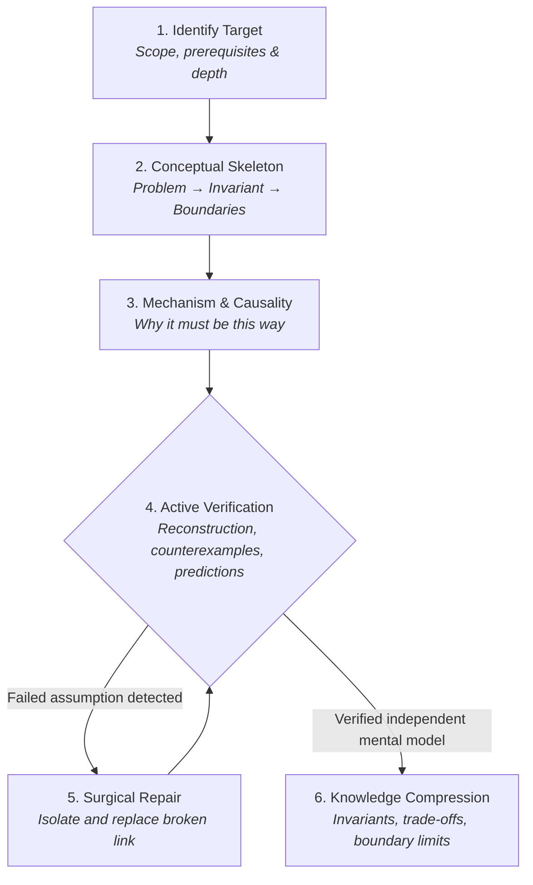

<div align="center">

# 🧠 Theory Learning

**An Agent Skill for durable theoretical understanding in CS, Mathematics, and Systems.**

> *"You can outsource explanation and exploration to an LLM, but you should not outsource understanding."*

[](./LICENSE)
[](#-installation--usage)
[](#-design-philosophy)

[English](./README.md) | [简体中文](./README_zh.md)

</div>

---

## ⚡ The Problem: The Illusion of Explanatory Depth

When learning complex theoretical subjects (distributed consensus, memory models, compiler optimizations, mathematical proofs, paper designs), default LLMs tend to:
- **Dump overwhelming encyclopedic facts** without establishing conceptual dependencies.
- **Produce plausible-sounding illusions of understanding**—you nod along while reading, but fail to reconstruct the idea 10 minutes later.
- **Rely on superficial summaries** and loose analogies that break down at boundary conditions.
- **Celebrate completion prematurely** the moment you say *"I get it"*.

**`theory-learning` shifts the LLM from an "encyclopedia generator" into a rigorous "mental model sparring partner".**

---

## 🥊 How It Compares

| Dimension | Default LLM Response | `theory-learning` Agent Skill |
| :--- | :--- | :--- |
| **Entry Point** | Dumps long definitions, history, and code snippets immediately. | **Skeleton First**: Defines target, prerequisites, problem, and invariant before details. |
| **Explanation Mode** | Focuses on *what* a concept does. | Focuses on **causal mechanisms, trade-offs, and why it must work this way**. |
| **Source Fidelity** | Blends facts, model assumptions, and analogies seamlessly. | **Strictly categorizes**: `Source-stated` vs `Reasonable inference` vs `Explanatory model`. |
| **Verification** | Passive: asks *"Does this make sense?"* | **Active & adversarial**: Demands reconstruction, derivations, predictions, and counterexamples. |
| **Error Handling** | Restarts the entire lecture from scratch. | **Surgical repair**: Diagnoses the exact broken assumption in your mental model. |
| **Compression** | Summarizes at the start (TL;DR). | Compresses **only after understanding has been proven**. |

---

## 🔄 The 6-Step Understanding Workflow



---

## 💡 Showcase: Active Verification in Action

Instead of nodding along to a passive lecture, the interaction forces active cognitive reconstruction:

```text
User: Explain how Raft leader election works.

Agent (with theory-learning):
[Skeleton]
The problem: How does a distributed cluster agree on exactly one leader without a central coordinator, 
even under network partitions and node crashes?
The core invariant: At most one leader can be elected in a given term (Election Safety).

Before we discuss heartbeat timers and candidate states:
Suppose Node A and Node B both become candidates in Term 2 simultaneously in a 5-node cluster.
Can they both receive 3 votes? Why or why not? What mathematical property guarantees this?
```

---

## 🎯 Best Suited For

- **Computer Systems & Architecture**: Memory consistency, concurrency models, consensus protocols, OS virtualization.
- **Algorithms & Proofs**: Invariants, loop terminations, amortized bounds, inductive proofs.
- **Research Papers**: Hypotheses, baseline comparison fairness, unstated assumptions, ablation validity.
- **Technical Architecture**: Trade-off surfaces, failure modes, backpressure design, invariant preservation.

---

## 📁 Repository Layout

```text
theory-learning/
├── SKILL.md       # Skill metadata, complete behavioral guidelines & workflow
├── README.md      # Project overview (English)
├── README_zh.md   # Project overview (简体中文)
└── LICENSE        # MIT License
```

---

## 🚀 Installation & Usage

This repository follows the open **Agent Skills** specification (`SKILL.md`).

### In Google Antigravity / Agentic IDEs
Place or clone the repository into your skills directory:

```bash
# Global skills directory
cd ~/.gemini/antigravity/skills
git clone https://github.com/mhb881/theory-learning.git

# Or workspace-level skills
cd your-project/.gemini/skills
git clone https://github.com/mhb881/theory-learning.git
```

### In Claude Code / Cursor / Windsurf / Other Coding Assistants
Copy or link the folder into your agent's custom instructions or skills path:

```bash
# Example for Claude Code / Project rules
cp theory-learning/SKILL.md .claude/skills/theory-learning/SKILL.md
```

### Triggering the Skill
The skill activates naturally when you ask questions requiring deep theoretical mastery:
- *"Help me understand the proof of correctness for the Paxos commit phase."*
- *"I'm reading the Raft paper. Let's break down Section 5.4 step-by-step."*
- *"Why does Transformer self-attention require positional encodings?"*

---

## 🏛 Design Philosophy

> Inspired by the disciplined, first-principles working methodology championed by Andrej Karpathy and classical theoretical pedagogy.

The goal is not to maximize the amount of information delivered. **The goal is to help you build a robust mental model that allows you to explain, derive, predict, and apply concepts completely independently.**

---

## 📄 License

Licensed under the [MIT License](./LICENSE).
