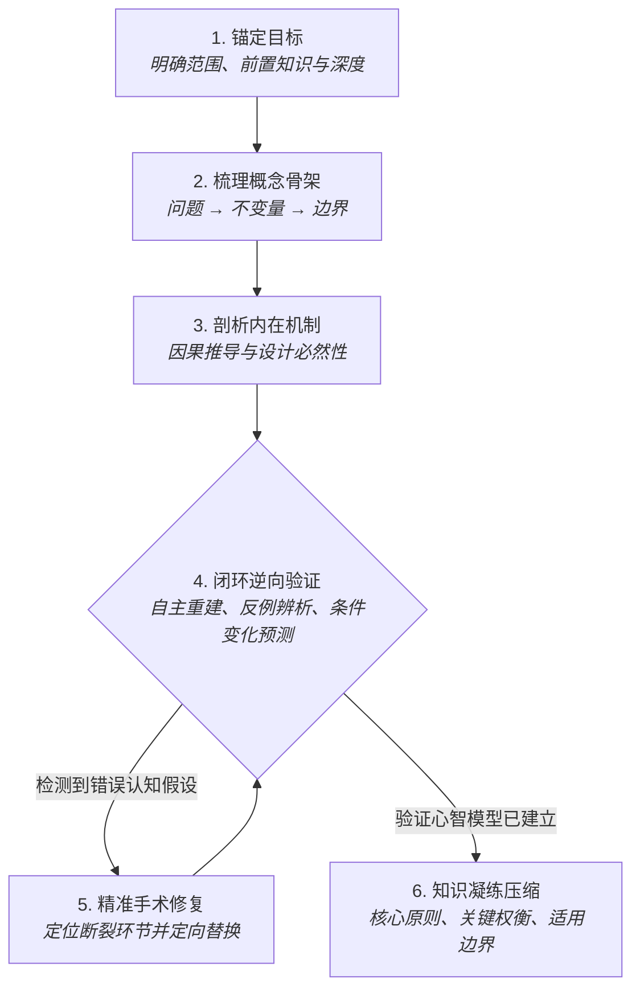

<div align="center">

# 🧠 Theory Learning

**专为计算机科学、数学与系统理论深度理解打造的 Agent Skill。**

> *"你可以把解释和探索外包给 LLM，但绝不应把‘理解’外包出去。"*

[](./LICENSE)
[](#-安装与使用)
[](#-设计哲学)

[English](./README.md) | [简体中文](./README_zh.md)

</div>

---

## ⚡ 痛点：被忽视的“解释深度假象”

在学习复杂的理论知识（分布式共识、内存一致性、编译器优化、数学证明、顶会论文架构设计）时，默认状态下的大语言模型（LLM）往往存在以下问题：
- **无节制的信息倾倒**：一上来就罗列海量名词、历史背景与代码细节，缺乏逻辑骨架。
- **看似听懂的虚假繁荣**：阅读时连连点头，合上聊天窗口后依然无法独立推导、预测和复现。
- **浅层摘要与粗糙类比**：在边界条件与极端情况下迅速崩溃。
- **过早庆祝完成**：只要用户说一句“我懂了”，AI 便停止深入考察。

**`theory-learning` 将 LLM 从一个“百科全书输出器”，转变成一个严格审视逻辑闭环的“心智模型陪练伙伴”。**

---

## 🥊 核心机制对比

| 维度 | 普通 AI 答疑 | `theory-learning` Agent Skill |
| :--- | :--- | :--- |
| **切入起点** | 立即倾倒长篇定义、背景与实现代码。 | **骨架先行**：先明确学习目标、前置知识、核心问题与不变量。 |
| **解释模式** | 侧重于描述“概念做了什么”。 | 侧重于阐述**因果机制、权衡取舍（Trade-offs）与“为什么必须如此设计”**。 |
| **信源严谨度** | 将事实、模型推论与随意类比混为一谈。 | **严格区分**：`原文直接论述` vs `合理推论` vs `解释性模型`。 |
| **理解验证** | 被动询问：“你明白了吗？” | **主动逆向测试**：要求自主复述、逆向推导、反例辨析与边界预测。 |
| **纠错修复** | 一旦出错，直接推倒从头重新讲一遍。 | **精准手术修复**：精准诊断心智模型中断裂的具体假设并予以替换。 |
| **知识压缩** | 一上来就给出速记小结（TL;DR）。 | **理解确立后**才进行精炼与压缩。 |

---

## 🔄 六步心智模型构建流



---

## 💡 实战演示：从被动听讲到主动推导

不再只是单向接受信息，AI 会引导你完成认知上的主动建构：

```text
用户: 请给我讲讲 Raft 的 Leader 选举流程。

Agent (搭载 theory-learning 模式):
[建立骨架]
要解决的问题：在无中央仲裁节点、存在网络分区与节点崩溃的环境下，集群如何就唯一的 Leader 达成一致？
核心不变量：在任意给定的任期（Term）内，至多只能选出一个 Leader（选举安全性）。

在我们深入心跳计时器和候选人状态机之前，请先思考一个关键边界：
假设在一个 5 节点的集群中，节点 A 和节点 B 在 Term 2 同时成为候选人发起投票。
它们有可能同时获得 3 票吗？为什么？这里依赖了什么数学性质来保证不变量？
```

---

## 🎯 最佳适用场景

- **计算机系统与架构**：内存一致性模型、并发协议、分布式共识（Raft/Paxos）、操作系统虚拟化机制。
- **算法与数学证明**：循环不变量、停机问题推导、平摊复杂度分析、归纳法证明。
- **顶会论文研读**：核心假设检验、基线对比公允性分析、消融实验有效性验证。
- **技术架构设计**：权衡取舍曲面（Trade-off surface）、故障模式（Failure Modes）、背压与容灾设计。

---

## 📁 仓库结构

```text
theory-learning/
├── SKILL.md       # Skill 元数据、完整行为指导准则与工作流
├── README.md      # 项目说明文档 (English)
├── README_zh.md   # 项目说明文档 (简体中文)
└── LICENSE        # MIT License 开源协议
```

---

## 🚀 安装与使用

本项目遵循开放的 **Agent Skills** 规范（基于 `SKILL.md`）。

### 在 Google Antigravity / 现代 Agentic IDE 中
将此仓库直接放入或克隆至对应的技能目录：

```bash
# 全局 Skills 目录
cd ~/.gemini/antigravity/skills
git clone https://github.com/mhb881/theory-learning.git

# 或当前项目工作区 Skills 目录
cd your-project/.gemini/skills
git clone https://github.com/mhb881/theory-learning.git
```

### 在 Claude Code / Cursor / Windsurf 等其他编码助手
复制或符号链接该目录至对应的 Agent 规则/指令路径：

```bash
# 例如 Claude Code / 项目级指令
cp theory-learning/SKILL.md .claude/skills/theory-learning/SKILL.md
```

### 触发 Skill
当你在提示词中提出需要深度理论掌控力的问题时，Skill 会自动激活：
- *"请帮我彻底搞懂 Paxos 提交阶段的正确性证明。"*
- *"我正在研读 Raft 论文，请带我逐步剖析第 5.4 节关于日志安全的推导。"*
- *"为什么 Transformer 的自注意力机制必须引入位置编码？"*

---

## 🏛 设计哲学

> 灵感源自 Andrej Karpathy 等学者与工程师倡导的、从第一性原理出发的自律工作流与古典理论教学法。

我们的目标不是最大化单次对话输出的信息量。**真正的目标，是帮助你建立起一个稳固的心智模型——让你能够完全脱离 AI，独立自如地解释、推导、预测并应用这一理论。**

---

## 📄 开源协议

基于 [MIT License](./LICENSE) 协议开源。
